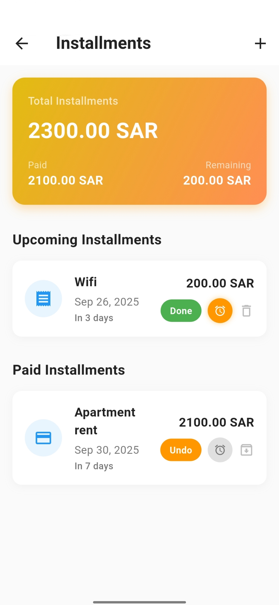
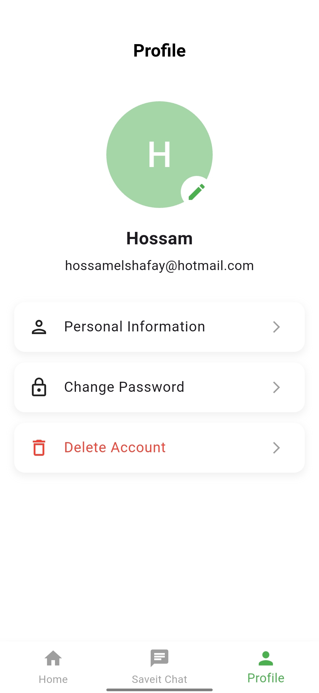

# SaveIt

SaveIt is a Flutter personal finance app for tracking income, expenses, installments, and spending trends. Its dashboard brings together the current balance, paid installments, and links to each financial screen.

## Features

- Record, edit, and delete income and expenses with dates, notes, and categories.
- Track upcoming and paid installments, change payment status, and review installment totals.
- Compare daily expenses and review weekly charts and monthly savings summaries.
- Create an email account, verify the email address, reset a password, sign in with Google, or continue as a guest.
- Manage profile details, change a password, delete an account, and choose English or Arabic.
- Chat with SaveIt using built-in responses. Signed-in accounts can keep chat history locally. The repository includes a placeholder for the existing Gemini fallback.

## Screenshots

These screenshots are included in the repository.

| Dashboard | Expenses | Savings |
| --- | --- | --- |
|  |  |  |

| Sign in | Installments | Profile |
| --- | --- | --- |
|  |  |  |

## Architecture

SaveIt uses feature-first Clean Architecture with Cubits as ViewModels. Screens and widgets render state, collect form input, and handle visual feedback. Cubits coordinate streams, validation, and mutations through repository contracts. Data sources handle Firebase and local persistence, including mapping Firestore documents into values the presentation layer can use.

```text
lib/
├── main.dart
├── firebase_options.dart
├── app/
│   ├── app.dart
│   ├── bootstrap.dart
│   ├── di/
│   ├── localization/
│   ├── router/
│   └── theme/
├── core/
│   ├── errors/
│   ├── utils/
│   └── widgets/
└── features/
    ├── auth/
    ├── balance/
    ├── chat/
    ├── dashboard/
    ├── expenses/
    ├── income/
    ├── installments/
    ├── profile/
    ├── savings/
    ├── settings/
    └── splash/
```

Features with storage have `data/`, `domain/`, and `presentation/` layers. Dashboard, settings, and splash contain presentation code. GoRouter declares screen routes and checks the current session before opening protected pages. GetIt owns dependencies, and Injectable generates registrations in `lib/app/di/injection.config.dart`. The app owns shared profile and settings state. Individual routes own their form and financial Cubits.

## Technology

| Area | Implementation |
| --- | --- |
| App and UI | Flutter 3.50, Dart 3.14, Material UI, Lottie, FL Chart |
| State and navigation | Flutter BLoC, Cubit, GoRouter |
| Dependency injection | GetIt, Injectable, build_runner |
| Backend | Firebase Authentication, Cloud Firestore, Cloud Storage |
| Local persistence and media | SharedPreferences, GetStorage, image_picker, audioplayers |

## Getting started

### Prerequisites

- Flutter 3.50.0 stable with Dart 3.14.0.
- An Android SDK with platform and build tools 36, Flutter’s NDK version, and a JDK 17 or newer supported by Gradle.
- The [Firebase CLI and FlutterFire CLI](https://firebase.google.com/docs/flutter/setup) if configuring a Firebase project.
- For an iOS build, macOS with Xcode 26.2 or newer, Swift Package Manager, and an iOS 15 or later target. Verify Firebase and Google Sign-In provisioning for the iOS app in Xcode.

Android uses Gradle 9.6.0, AGP 9.3.1, built-in Kotlin 2.4.20, and Google Services 4.4.4. The Java and Kotlin bytecode targets are 17. The wrapper selects the Gradle distribution. The audio plugin’s test integration currently relies on AGP’s legacy DSL compatibility flag. Kotlin compiles in the Gradle process with incremental compilation disabled to avoid the Windows compiler-cache failure.

### Install and run

Complete Firebase setup before the first run.

```sh
git clone https://github.com/hossamelshafay/saveit.git
cd saveit
flutter doctor -v
flutter pub get
dart run build_runner build
flutter run
```

### Firebase setup

1. Obtain access to the existing SaveIt Firebase project before setting up a shared environment. For a separate development project, register an Android app with package `com.example.final_project`, an iOS app with bundle ID `com.example.saveltApp`, and a web app if needed.
2. Run `flutterfire configure` from the project root and select the intended project and platforms. Keep `lib/firebase_options.dart`, `android/app/google-services.json`, and any Apple `GoogleService-Info.plist` files local. Generate or obtain them before running the app or tests. Keep service-account credentials and signing keys outside the repository.
3. Enable Email/Password, Google, and Anonymous sign-in in Firebase Authentication. Register the Android signing certificate fingerprints for Google Sign-In and configure its OAuth client for each platform you use.
4. Provision Cloud Firestore and Cloud Storage with access rules scoped to authenticated users and their own records. The app uses the `users` collection, its `incomes`, `expenses`, `installments`, and `savings` subcollections, and the storage path `users/{uid}/profile.jpg`.

SaveIt Chat uses its built-in replies by default. For local development, supply `SAVEIT_GEMINI_API_KEY` through an ignored JSON file with `flutter run --dart-define-from-file=.env.gemini.json`. Dart defines are readable from app binaries. Use a backend for shared or production builds that require a private Gemini credential.

### Validate and build

```sh
flutter pub get
dart run build_runner build
dart format lib test
flutter analyze
flutter test
flutter build apk --debug
```

Flutter writes the debug APK to `build/app/outputs/flutter-apk/app-debug.apk`. On Windows, keep the workspace and Dart’s package cache on the same drive to avoid Kotlin’s cross-drive incremental compilation error. Set `PUB_CACHE` for the current shell before running `flutter pub get` if needed.
