<div align="center">

# SaveIt

**Personal Finance & Budget Management App built with Flutter, Clean Architecture, and Firebase**

[](https://flutter.dev)
[](https://dart.dev)
[](https://bloclibrary.dev)
[](#architecture)
[](https://firebase.google.com)
[](#android-build-modernization)

<br/>

[](https://skillicons.dev)

</div>

---

## Overview

**SaveIt** is a personal finance application for tracking income, expenses, installments, balance totals, and daily/monthly savings trends. Built as a showcase of production-oriented Flutter engineering, the codebase is structured around **Feature-first Clean Architecture** and **MVVM with BLoC/Cubit**, separating UI rendering, state orchestration, domain contracts, and Firebase/local data sources.

---

## Tech Stack

| Layer / Domain | Technologies & Packages |
| --- | --- |
| **Framework & Language** | Flutter `3.50.0`, Dart `3.14.0`, Material UI (`material_ui`) |
| **Architecture & Patterns** | Feature-first Clean Architecture, MVVM, Repository Pattern, SOLID |
| **State Management** | `flutter_bloc` (`Cubit` ViewModels), `WatchCubit` stream utility |
| **Dependency Injection** | `get_it`, `injectable`, `injectable_generator`, `build_runner` |
| **Navigation & Guards** | `go_router` (declarative routing with auth session `route_guards`) |
| **Backend & Auth** | `firebase_core`, `firebase_auth`, `cloud_firestore`, `firebase_storage`, `firebase_messaging`, `firebase_analytics`, `google_sign_in`, `flutter_facebook_auth` |
| **AI & Networking** | `google_generative_ai` (Gemini fallback via `--dart-define`), `http`, `googleapis_auth` |
| **Local Persistence & Jobs** | `shared_preferences`, `get_storage`, `workmanager` (daily savings background tasks) |
| **UI, Charts & Media** | `fl_chart`, `lottie`, `image_picker`, `audioplayers`, `intl` (EN / AR localization) |
| **Android Build Toolchain** | Gradle `9.6.0`, AGP `9.3.1`, Built-in Kotlin `2.4.20`, Google Services `4.4.4`, JVM `17` |

---

## Core Features

- **Dashboard & Balance Overview**: Live summary of remaining balance, total income, paid installments, and quick navigation across financial modules.
- **Income & Expense Management**: Full CRUD workflows with categories, dates, notes, audio feedback, and real-time Firestore synchronization.
- **Installments Tracking**: Manage upcoming and paid installments, toggle payment status, and inspect due-status calculations.
- **Savings & Analytics**: Daily savings comparisons, weekly spending charts (`fl_chart`), monthly summaries, and background calculation scheduling (`workmanager`).
- **Authentication & Profile**: Email/Password sign-up & verification, password recovery, Google Sign-In, Facebook Auth, anonymous guest mode, profile editing, password updates, and account deletion.
- **SaveIt Assistant Chat**: Built-in local response engine with optional Gemini AI fallback and local chat history persistence for signed-in users.
- **Localization & Theming**: English and Arabic translations (`app_translations.dart`) with centralized Light/Dark theme tokens.

---

## Architecture

SaveIt follows a **Feature-first Clean Architecture** paired with **MVVM**:

- **Presentation Layer (`screens/`, `widgets/`, `cubit/`)**: Widgets remain declarative and lean; `Cubit` ViewModels manage UI state, validation, and stream subscriptions.
- **Domain Layer (`entities/`, `repositories/`)**: Pure Dart entities and abstract repository contracts decouple business rules from external SDKs.
- **Data Layer (`data_sources/`, `models/`, `repositories/`)**: Concrete repository implementations coordinate Firebase (Auth, Firestore, Storage), local persistence (`SharedPreferences`, `GetStorage`), `Workmanager`, and Gemini AI.


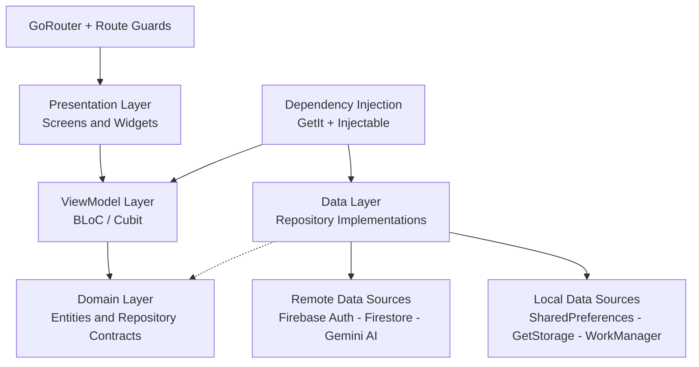


### Project Structure

```text
lib/
├── main.dart                     # App entry point
├── app/
│   ├── app.dart                  # Root MaterialApp.router & global providers
│   ├── bootstrap.dart            # Firebase, storage, DI & background task init
│   ├── di/                       # GetIt & Injectable configuration
│   ├── localization/             # English & Arabic translations
│   ├── router/                   # GoRouter routes & auth session guards
│   └── theme/                    # Colors, dimensions, text styles & themes
├── core/
│   ├── errors/                   # Centralized ErrorHandler, Exceptions & Failures
│   ├── utils/                    # WatchCubit & shared helpers
│   └── widgets/                  # Reusable UI feedback & shared components
└── features/
    ├── auth/                     # Login, registration, password recovery, guards
    ├── balance/                  # Aggregated balance & totals
    ├── chat/                     # Local chat engine & Gemini AI fallback
    ├── dashboard/                # Home overview & navigation grid
    ├── expenses/                 # Expense CRUD & category widgets
    ├── income/                   # Income CRUD
    ├── installments/             # Installment tracking & status updates
    ├── profile/                  # Profile, password change & account deletion
    ├── savings/                  # Daily/monthly savings, charts & Workmanager
    ├── settings/                 # Language & theme preferences
    └── splash/                   # Initial session routing
```

---

## Engineering Highlights

- **SOLID & Separation of Concerns**: Dependencies flow inward toward domain repository contracts, keeping Firebase and storage SDKs isolated behind data sources.
- **Centralized Error Handling**: `lib/core/errors/` standardizes exception-to-failure mapping (`error_handler.dart`, `exceptions.dart`, `failures.dart`) paired with reusable UI messaging (`app_message.dart`).
- **Code Modularity (400-Line File Limit)**: Every Dart source file under `lib/` is kept at or below 400 lines by decomposing large screens into focused feature widgets and form cubits.
- **Automated Verification**:
  - **10/10 passing unit & widget regression tests** (`balance_totals_test.dart`, `dependencies_test.dart`, `installment_due_status_test.dart`, `savings_test.dart`, `widget_test.dart`).
  - **Zero `dart analyze` issues** across the codebase.
  - **Successful Android debug build** on the modernized toolchain.

### Android Build Modernization

- Upgraded Android build stack to **Gradle 9.6.0**, **AGP 9.3.1**, **Built-in Kotlin 2.4.20**, and **Google Services 4.4.4** targeting **JVM 17**.
- Configured `android.builtInKotlin=true` and updated Android plugin implementations (`audioplayers_android`, `shared_preferences_android`, `workmanager_android`) for compatibility.

---

## Screenshots

<table>
  <tr>
    <td align="center">
      
      <br/><sub>Splash</sub>
    </td>
    <td align="center">
      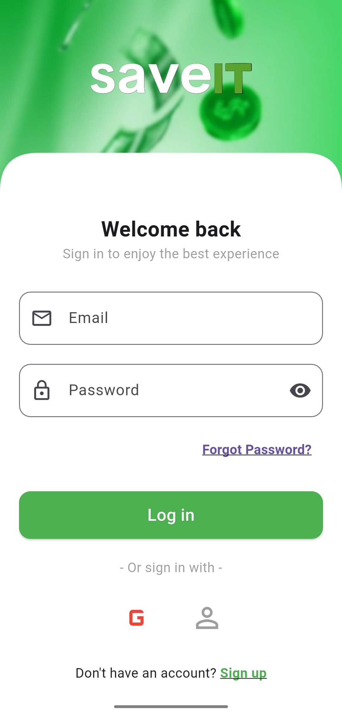
      <br/><sub>Sign In</sub>
    </td>
    <td align="center">
      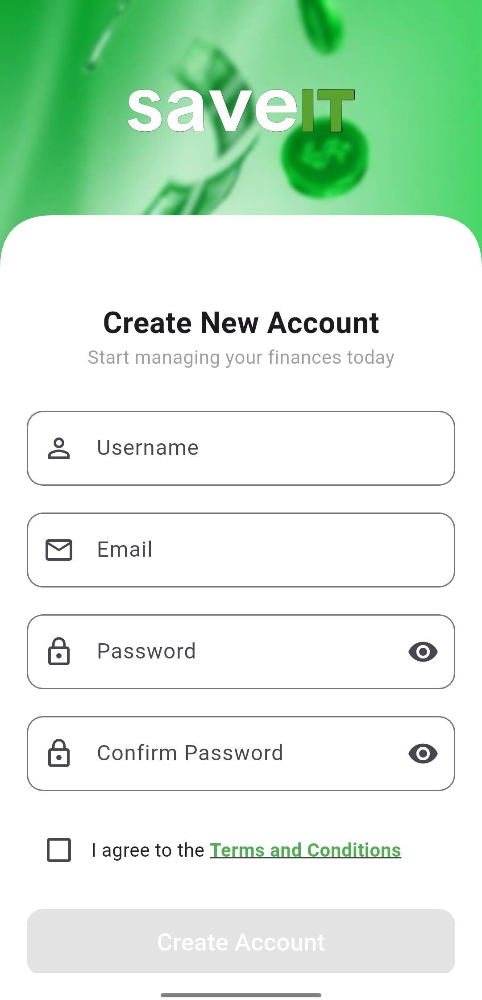
      <br/><sub>Sign Up</sub>
    </td>
    <td align="center">
      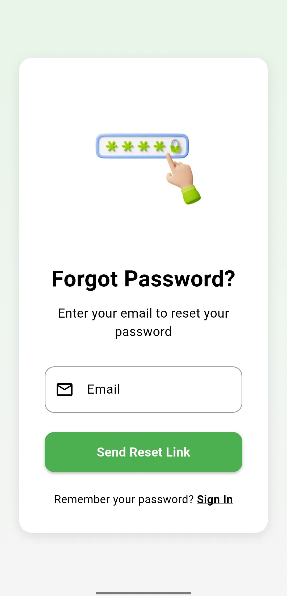
      <br/><sub>Forgot Password</sub>
    </td>
  </tr>
  <tr>
    <td align="center">
      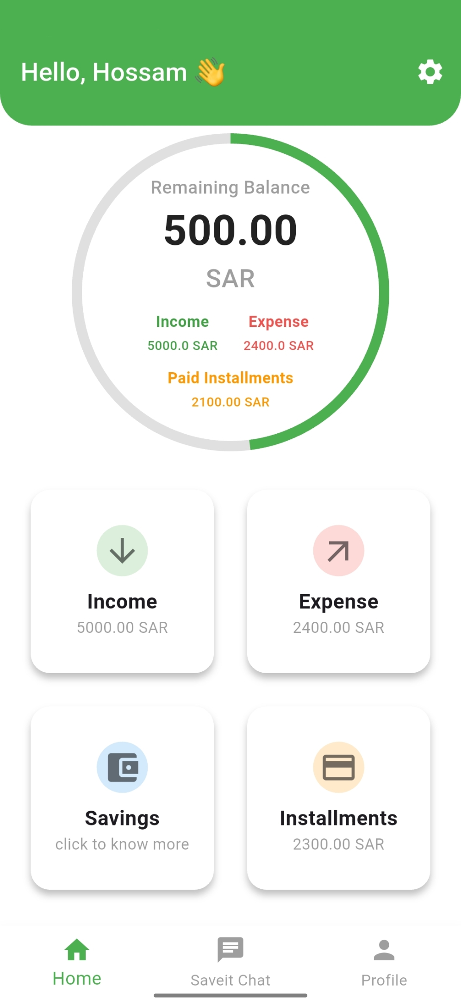
      <br/><sub>Dashboard</sub>
    </td>
    <td align="center">
      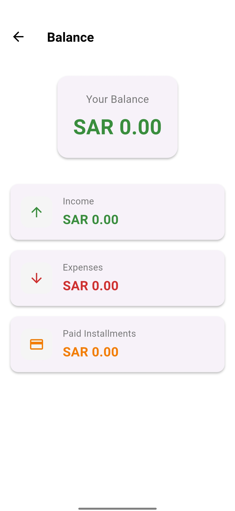
      <br/><sub>Balance</sub>
    </td>
    <td align="center">
      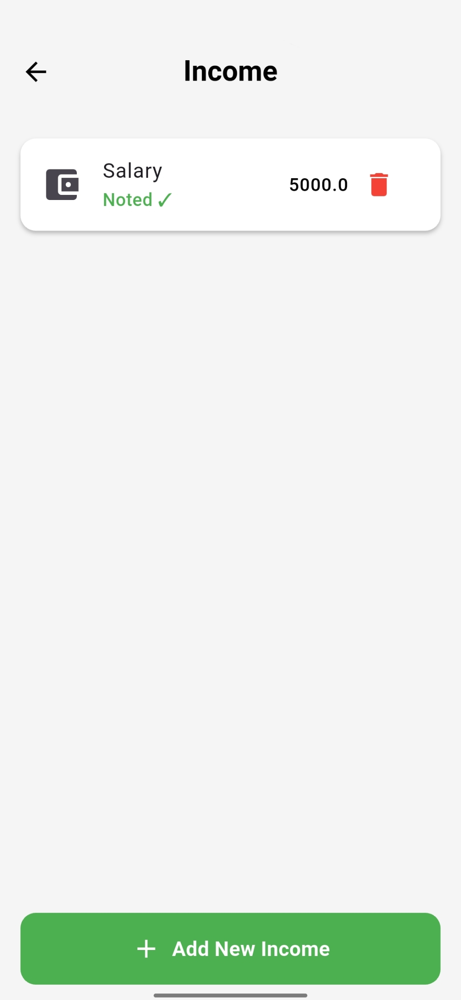
      <br/><sub>Income</sub>
    </td>
    <td align="center">
      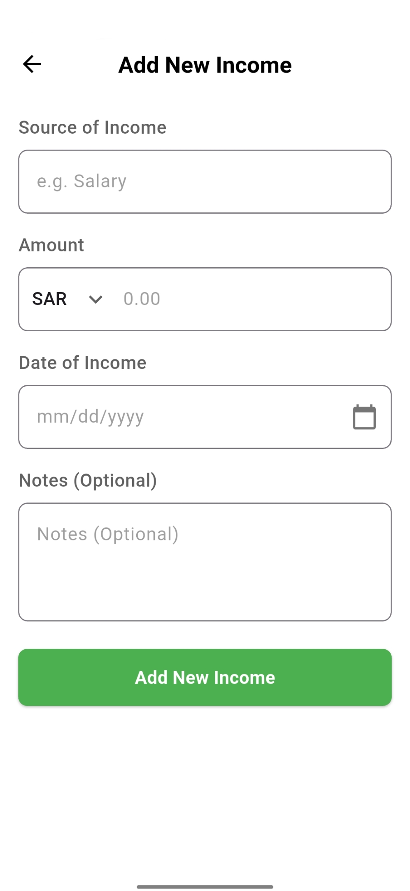
      <br/><sub>Add Income</sub>
    </td>
  </tr>
  <tr>
    <td align="center">
      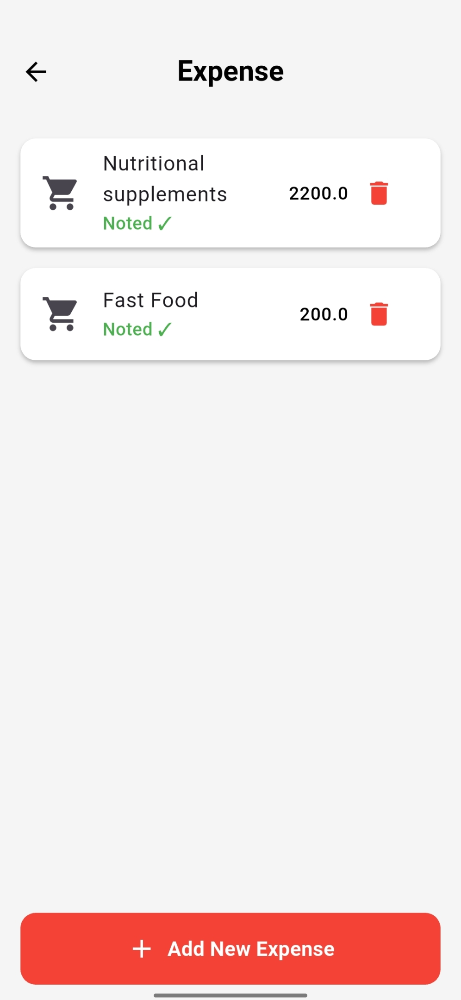
      <br/><sub>Expenses</sub>
    </td>
    <td align="center">
      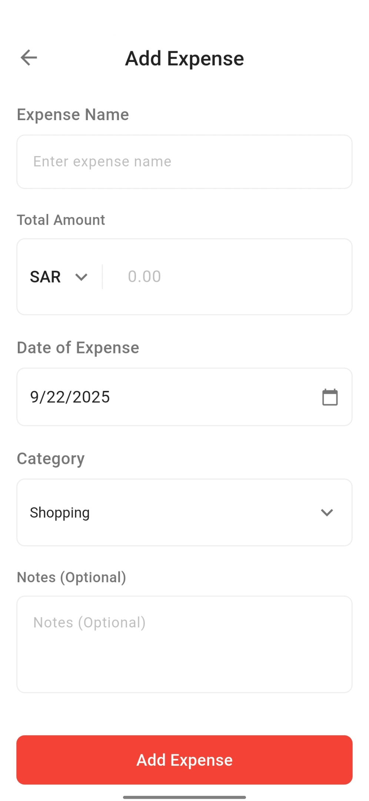
      <br/><sub>Add Expense</sub>
    </td>
    <td align="center">
      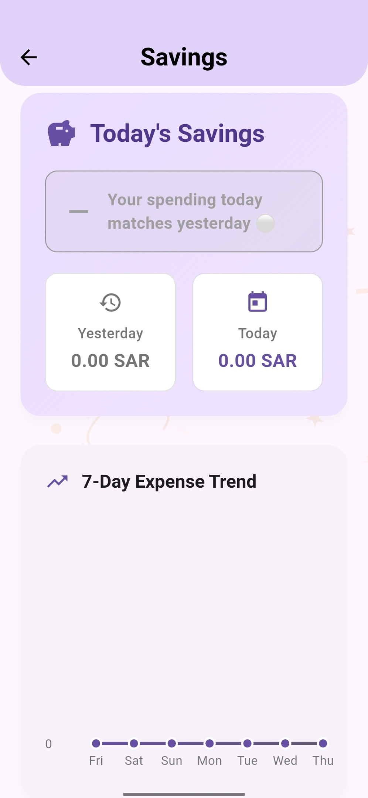
      <br/><sub>Savings</sub>
    </td>
    <td align="center">
      
      <br/><sub>Installments</sub>
    </td>
  </tr>
  <tr>
    <td align="center">
      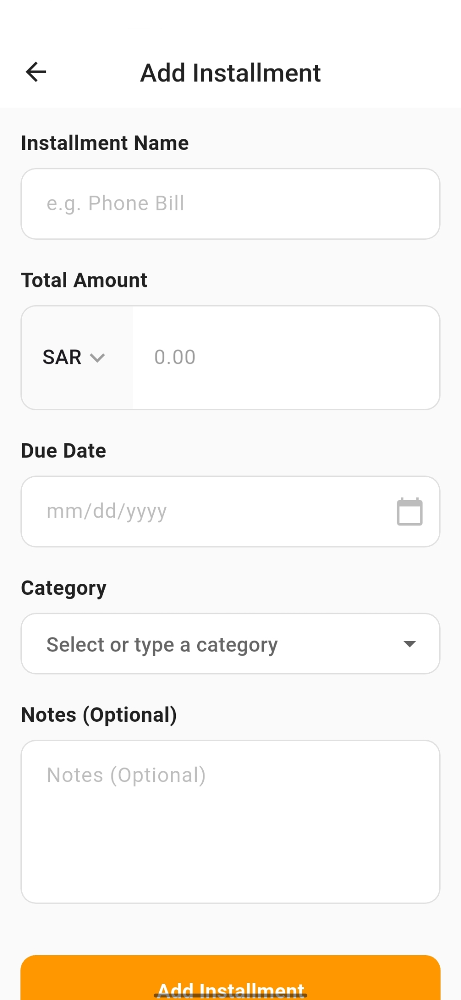
      <br/><sub>Add Installment</sub>
    </td>
    <td align="center">
      
      <br/><sub>Profile</sub>
    </td>
    <td align="center">
      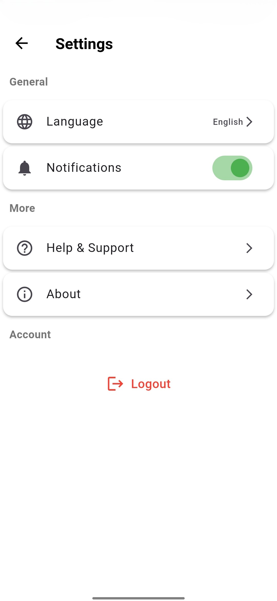
      <br/><sub>Settings</sub>
    </td>
    <td align="center">
      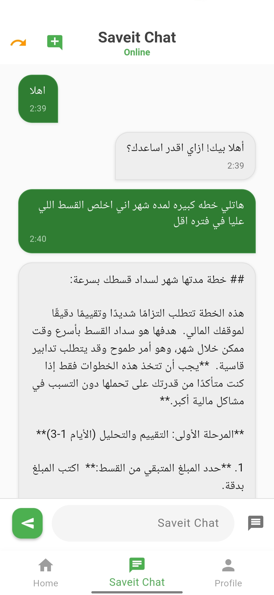
      <br/><sub>SaveIt Chat</sub>
    </td>
  </tr>
</table>

---

## Getting Started

### Prerequisites

- **Flutter** `3.50.0+` / **Dart** `3.14.0+`
- **JDK 17+** & **Android SDK** (for Android builds)
- **Firebase CLI & FlutterFire CLI**

### Installation

```bash
git clone https://github.com/hossamelshafay/saveit.git
cd saveit
flutter pub get
```

### Firebase & Environment Setup

Firebase configuration files (`lib/firebase_options.dart`, `android/app/google-services.json`, `ios/Runner/GoogleService-Info.plist`) and API secrets are excluded from Git.

1. Create a Firebase project and enable **Authentication** (Email/Password, Google, Anonymous/Facebook as needed), **Cloud Firestore**, and **Cloud Storage**.
2. Place `google-services.json` in `android/app/` (and `GoogleService-Info.plist` in `ios/Runner/` for iOS), then generate `lib/firebase_options.dart` via:
   ```bash
   flutterfire configure
   ```
3. *(Optional)* Provide a Gemini API key at build/run time without committing it:
   ```bash
   flutter run --dart-define=SAVEIT_GEMINI_API_KEY=your_api_key
   ```

> **Note on Live Authentication:** Auth routing, form validation, and repository wiring are covered by automated widget/unit tests, while end-to-end **live authentication** against a production Firebase project (Email/Password, Google Sign-In, Facebook Auth) is **currently unverified** and depends on your local Firebase project configuration and SHA-1/OAuth setup.

### Run & Verify

```bash
flutter run
flutter test
dart analyze
```

---

## License

This project is available under the terms of the repository's `LICENSE` file.
